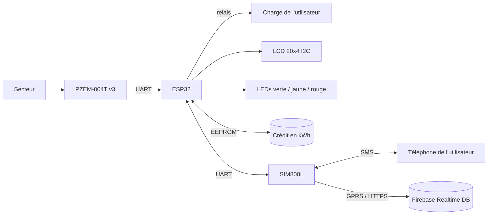

# ⚡ Compteur d'énergie prépayé intelligent (version GSM)

Compteur électrique **prépayé** à base d'ESP32 : il mesure la consommation d'une installation monophasée, décompte un crédit en kWh, coupe automatiquement le courant quand le crédit est épuisé, et se pilote **par SMS**. Les mesures sont envoyées en temps réel vers **Firebase** via le réseau GPRS.

> Pensé pour les zones où le Wi-Fi n'est pas fiable : toute la communication passe par le réseau GSM.

---

## 🎯 Contexte et objectif

Dans de nombreux foyers, le suivi de la consommation et le paiement de l'électricité restent peu pratiques : relevés manuels, factures tardives, coupures décidées à distance.

**Objectif** : concevoir un compteur qui permet à l'utilisateur de **payer à l'avance l'énergie qu'il consomme**, de **recharger son crédit à distance** par SMS, d'être **alerté** avant l'épuisement, et dont les données de consommation sont **consultables en ligne**.

---

## ✨ Fonctionnalités

- **Mesure en temps réel** : tension, courant, puissance, énergie cumulée, facteur de puissance (PZEM-004T v3).
- **Crédit prépayé** en kWh, sauvegardé en mémoire non volatile (il survit aux coupures de courant).
- **Coupure automatique** par relais quand le crédit est épuisé.
- **Rechargement par SMS** : `montant=<kWh>`.
- **Alertes SMS** : crédit faible (80 % consommés) et crédit épuisé.
- **Signalisation locale** : LEDs verte / jaune / rouge et afficheur LCD 20×4.
- **Télémétrie cloud** : envoi horodaté des mesures vers Firebase Realtime Database toutes les minutes.

---

## ⚙️ Principe de fonctionnement

1. Le **PZEM-004T** mesure en continu les grandeurs électriques de la charge.
2. L'**ESP32** calcule l'énergie consommée et la retranche du crédit restant.
3. Selon le niveau du crédit, il commande le **relais** (coupure ou maintien) et les **LEDs**.
4. Le **SIM800L** reçoit les SMS de rechargement, envoie les alertes et transmet les mesures à **Firebase** en GPRS.
5. Le crédit est sauvegardé régulièrement en **EEPROM**.



---

## 🚦 États du compteur

| État | Condition | Relais | LED | SMS envoyé |
|---|---|---|---|---|
| Normal | Crédit ≥ 20 % de la dernière recharge | Fermé (courant ON) | 🟢 | — |
| Crédit faible | Crédit < 20 % de la dernière recharge | Fermé | 🟡 | « 80 % consommés… » (une fois) |
| Épuisé | Crédit ≤ 0 | **Ouvert (courant OFF)** | 🔴 | « Rechargement épuisé » (une fois) |

---

## 📲 Commandes SMS

| SMS envoyé au compteur | Effet |
|---|---|
| `montant=25` | Ajoute 25 kWh au crédit, le sauvegarde et répond par SMS avec le nouveau solde |
| Tout autre texte | Réponse d'erreur indiquant le format attendu |

---

## ☁️ Données envoyées

Chemin Firebase : `/consoEnTempsReel/compteurID_1`

```json
{
  "date": "25/10/23,14:30",
  "tension": "229.8000",
  "courant": "1.2000",
  "kWh restant": "18.4200",
  "cosphi": "0.9500",
  "puissance": "260.0000",
  "energie": "1.5800"
}
```

---

## 🧰 Matériel

| Composant | Rôle |
|---|---|
| ESP32 DevKit | Microcontrôleur principal |
| PZEM-004T v3.0 | Mesure V / I / P / E / PF / f (UART, Modbus) |
| SIM800L | SMS + GPRS (HTTP/SSL) |
| LCD 20×4 I2C (adresse `0x27`) | Affichage local |
| Module relais | Coupure de la charge |
| 3 LEDs (verte, jaune, rouge) + résistances | Indicateurs d'état |
| Alimentation 4 V / 2 A | Dédiée au SIM800L (pics de courant jusqu'à ~2 A) |
| Carte SIM | SMS et data activés, code PIN désactivé |

> ⚠️ **Sécurité** : le PZEM-004T et le relais sont raccordés au secteur (230 V). Travaillez hors tension, utilisez un boîtier isolé et faites valider le montage par une personne qualifiée.

---

## 🗂️ Structure du dépôt

```
.
├── README.md                  # Ce fichier : présentation générale du projet
├── firmware/
│   ├── README.md              # Documentation du code embarqué
│   └── compteur_code/
│       ├── compteur_code.ino                  # Programme principal
│       ├── envoi_donnees.ino                  # GPRS + envoi Firebase
│       ├── envoi_reponse_tel.ino              # Envoi de SMS
│       ├── recuperer_montant.ino              # Lecture des SMS de rechargement
│       └── ecriture_recuperation_memoire.ino  # Sauvegarde / lecture EEPROM
└── docs/                      # Schémas, photos (à ajouter)
```

👉 Le détail du code (câblage, configuration, fonctionnement) est dans [`firmware/README.md`](firmware/README.md).

---

## 👤 Auteur

**Othniel AHUI** — Ingénieur en génie énergétique et procédés (ENSGEP – UNSTIM), Bénin.

**Bertrand AGBADO** — Ingénieur en génie énergétique et procédés (ENSGEP – UNSTIM), Bénin.


